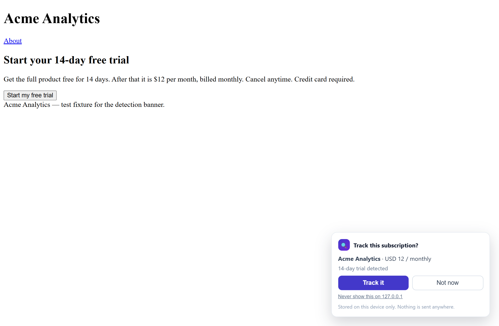
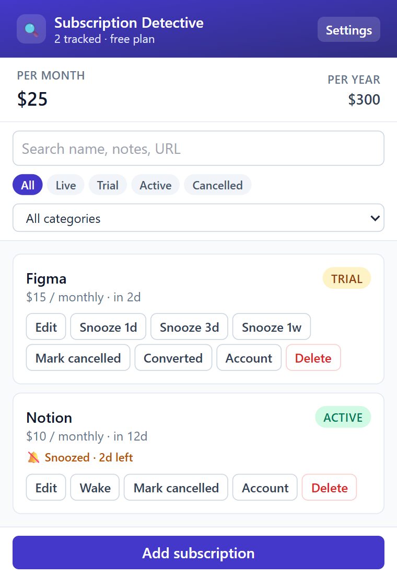
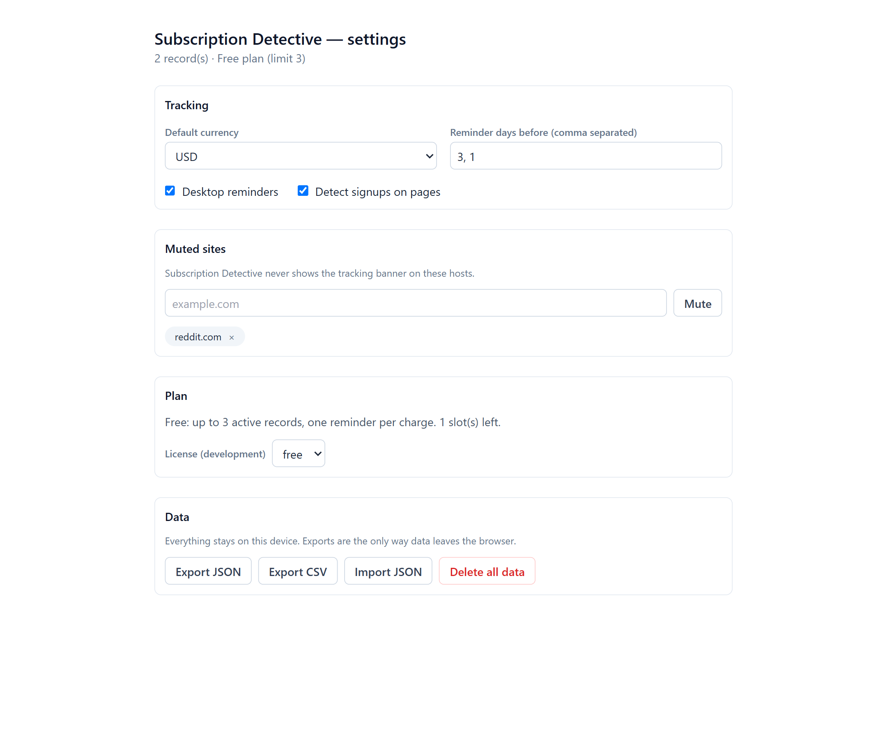

<h1 align="center">Subscription Detective</h1>

<p align="center">
  Catches the free trials you forgot about, before they charge your card.
</p>

<p align="center">
  
  
  
  
  
</p>

<p align="center">
  
</p>

Subscription Detective is a Chrome extension that notices when you start a trial
or subscribe to something, records it with one click, and reminds you a few days
before the money leaves — while you still have time to cancel. Everything stays
in `chrome.storage.local`. There is no account, no server and no analytics.

---

## Contents

- [Why](#why)
- [Features](#features)
- [Screenshots](#screenshots)
- [Install](#install)
- [Usage](#usage)
- [How it works](#how-it-works)
- [Permissions](#permissions)
- [Privacy](#privacy)
- [Testing](#testing)
- [Project structure](#project-structure)
- [Documentation](#documentation)
- [Status and roadmap](#status-and-roadmap)
- [Contributing](#contributing)
- [License](#license)

## Why

Free trials are designed to be forgotten. A 14-day trial started on a Friday is
easy to lose, the "we'll remind you" email goes to spam, and by the time the
receipt arrives the charge is already made.

Subscription Detective closes that gap at the only moment you are paying
attention: the signup page itself. It reads the offer on screen, asks "Track this
subscription?", and remembers the price and the date so you do not have to.

## Features

| Find | Track | Remember | Own |
|---|---|---|---|
| Detects trial and subscription signups from page text, URL patterns and 25 site rules | One-click add from the banner, or add manually | Desktop reminder before each charge | Everything stored locally in `chrome.storage.local` |
| Prefills service name, price, currency, billing cycle and trial length | Edit, cancel, convert or delete a record | Badge count for charges in the next 7 days | Export to JSON or CSV, import back |
| Silent on pages that are not signups, and on sites you mute | Filter by status, category, or search | Snooze one record for a day, three days or a week | Delete everything with one button |

Also included: monthly and yearly spend totals across live subscriptions, a
per-record account link so cancelling is one click away, and a free tier that
tracks 3 active subscriptions with one reminder each.

## Screenshots

| Popup | Settings |
|---|---|
|  |  |

## Install

Requires Node 18+ and Chrome 116+.

```bash
git clone <your-fork-url> subscription-detective
cd subscription-detective
npm install
npm run build          # → build/chrome-mv3-prod
```

Then load it:

1. Open `chrome://extensions`
2. Turn on **Developer mode**
3. **Load unpacked** → select `build/chrome-mv3-prod`

For development with hot reload:

```bash
npm run dev            # → build/chrome-mv3-dev, load that folder instead
```

Other scripts:

| Command | What it does |
|---|---|
| `npm run build` | Production build |
| `npm run package` | Zip for the Chrome Web Store |
| `npm test` | Unit tests (Vitest) |
| `npm run test:e2e` | Browser suites against the built extension (Playwright) |
| `npm run test:all` | Unit tests → build → both browser suites |
| `npm run lint` / `npm run format` | ESLint / Prettier |

## Usage

1. **Sign up for a trial.** If the page looks like a trial or subscription
   offer, a banner appears in the corner with the name, price and trial length it
   could read.
2. **Confirm it.** One click saves the record and schedules reminders. Nothing is
   saved without that click, and nothing is ever sent anywhere.
3. **Get reminded** three days and one day before the charge (paid) or one day
   before (free). Click the notification to jump to the service's account page.
4. **Keep it honest.** Mark a trial as converted or cancelled, snooze a record
   when you are not ready to decide, or fix a wrong price. Settings holds your
   default currency, reminder timing, muted sites and data export.

## How it works

- `src/contents/detector.jsx` scores the page in a content script (keywords,
  billing URLs, known sites), extracts price and dates with pure parsers, and
  renders a banner inside a shadow root. It never writes storage.
- `src/background/` owns every mutation: it applies the free-tier limit, saves
  records, rebuilds `chrome.alarms` and raises notifications.
- `src/lib/` is pure logic — schedule maths, currency, detection scoring, filters,
  snooze rules, export — which is why most of it is covered by unit tests.

Full detail, including the data model and the decisions behind it:
[docs/ARCHITECTURE.md](docs/ARCHITECTURE.md).

## Permissions

| Permission | Why it is needed |
|---|---|
| `storage` | Subscriptions and settings, kept locally |
| `alarms` | Reminder scheduling that survives the service worker sleeping |
| `notifications` | Desktop reminders with an account-page button |
| Host access (`<all_urls>`) | To recognise a signup page on the site where it happens |

## Privacy

- No network requests from the extension. No account, no telemetry, no remote
  code — the bundle ships every rule it uses.
- Page text is read in the tab, scored locally and discarded. Only the fields you
  confirm are stored, and only on this device.
- Uninstalling the extension deletes its data; settings also has "Delete all
  data" and JSON export if you want a copy first.

## Testing

```bash
npm test               # 146 unit tests, 10 files
npm run test:e2e       # 52 browser checks across two Playwright suites
npm run test:all       # everything, in the right order
```

| Layer | Covers |
|---|---|
| Unit (Vitest) | Cycle maths, parsing, detection scoring, filtering, snooze rules, export/import, licence gates, and the alarm scheduler against a fake `chrome` API |
| `tests/e2e/smoke.mjs` | Loads the built extension: popup, options, add/persist, alarms for free vs paid, filters, snooze and wake, upgrade prompt |
| `tests/e2e/detection.mjs` | Serves `tests/fixtures/` over localhost and drives the real banner: positive page, negative page, save, mute |

Not covered automatically: notification delivery on screen, the toolbar badge,
restart rescheduling, export/import through a file picker, accessibility, and a
live-site detection hit rate. Details and the manual matrix live in
[docs/TESTING.md](docs/TESTING.md).

## Project structure

```
src/
├── background/      service worker: messages, alarms, notifications, badge
├── contents/        detector + tracking banner
├── popup/           list, filters, snooze, add/edit form
├── options/         currency, reminders, muted sites, licence, export
└── lib/             pure logic + detection rules (no React, no chrome.*)
tests/
├── unit/            146 Vitest tests
├── e2e/             Playwright suites against the built extension
└── fixtures/        deterministic pages for detection
docs/                architecture, progress, features, testing and the spec
```

Annotated tree and placement rules: [docs/FOLDER_STRUCTURE.md](docs/FOLDER_STRUCTURE.md).

## Documentation

| Document | Purpose |
|---|---|
| [Requirements](docs/subscription-detective-requirements.md) | Source of truth for scope (FR-1 … FR-42) |
| [Architecture](docs/ARCHITECTURE.md) | Stack, module map, data flow, permissions, decisions |
| [Folder structure](docs/FOLDER_STRUCTURE.md) | Annotated tree and where new code belongs |
| [Plan](docs/PLAN.md) | Phases, tasks and exit criteria |
| [Progress](docs/PROGRESS.md) | What is built, what is verified, bugs found |
| [Features](docs/FEATURES.md) | Every requirement with a status and evidence |
| [TODO](docs/TODO.md) | Step-level checklist of what is left |
| [Testing](docs/TESTING.md) | Commands, coverage, manual matrix |
| [Limitations](docs/LIMITATIONS.md) | Known constraints before promising anything |

## Status and roadmap

**Working and verified in a real browser:** detection on a signup page, capture
with one click, storage, filters, snooze, free-tier cap, free-vs-paid reminder
counts, options, mute.

**Built but not yet exercised:** notification delivery, badge, restart
reschedule, export/import through the file picker, edit/delete, inline edit
before saving.

**Not built:**

- [ ] Payment provider and pricing (the paid plan is a local flag today)
- [ ] Optional encrypted sync (post-v1)
- [ ] Manage-page detection flow (FR-8)
- [ ] Accessibility audit, localisation, Edge/Brave check

Requirements coverage is tracked honestly in
[docs/FEATURES.md](docs/FEATURES.md): 24 of 42 verified, 16 written but
unverified, 2 not started.

## Contributing

Issues and pull requests are welcome. Please keep the layering intact — React
only in the UI entries, `chrome.*` only in `src/background/` and
`src/lib/storage.js` — and run `npm run test:all` before opening a PR. Update the
matching doc in `docs/` in the same commit; a phase is only done when its exit
criteria are met and the evidence is recorded.

## License

MIT. See [package.json](package.json) for the package metadata.

Subscription Detective is not financial advice and does not cancel anything for
you. Detection is best-effort: it can miss an offer, and it never verifies a
charge with the merchant.
